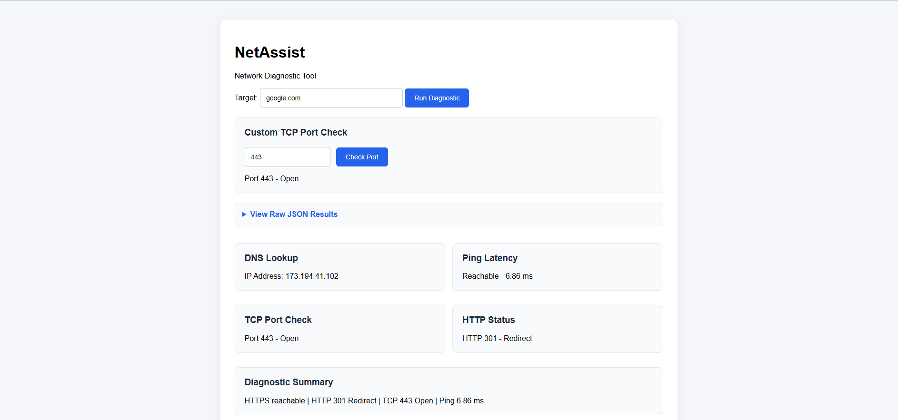
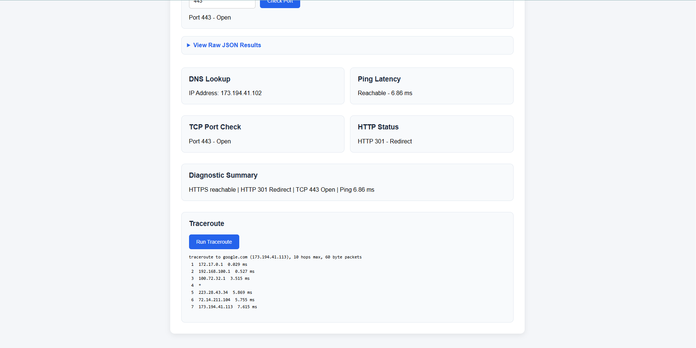
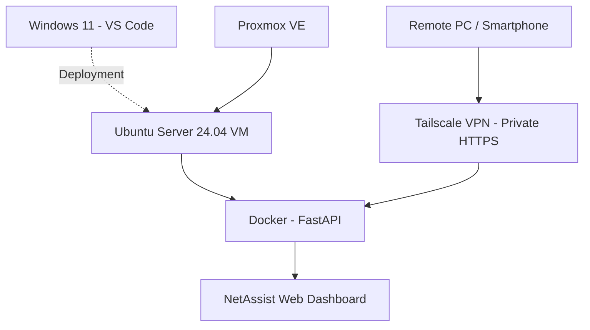

# NetAssist — Network Diagnostic Web Application

**A self-hosted network troubleshooting dashboard built with Python, FastAPI, Docker, and Ubuntu Server.**

NetAssist is a personal infrastructure and software development project designed to simplify common network troubleshooting tasks through a web-based interface.

The application runs inside a Docker container hosted on an Ubuntu Server virtual machine under Proxmox VE. It is accessible over the local network and remotely through a private Tailscale network.

## Application Screenshots

### Network Diagnostic Dashboard



### Traceroute and Diagnostic Results



## Key Features

| Feature | Description |
|---|---|
| DNS Lookup | Resolve hostnames to IPv4 addresses |
| ICMP Ping | Check host reachability and response time |
| TCP Port Check | Test TCP connectivity to a specified port |
| HTTP/HTTPS Check | Inspect website response status codes and redirects |
| Traceroute | Display network hops toward a destination |
| Network Diagnosis | Run multiple diagnostic checks and summarize the results |
| Web Dashboard | Execute diagnostic tools through an interactive browser interface |

## Technology Stack

**Backend**
- Python
- FastAPI
- HTTP requests and Python networking libraries

**Frontend**
- HTML
- CSS
- JavaScript

**Infrastructure**
- Ubuntu Server 24.04 LTS
- Docker
- Proxmox Virtual Environment
- Tailscale VPN and Tailscale Serve

**Development and Version Control**
- Windows 11
- Visual Studio Code
- Git
- GitHub

## System Architecture



**Deployment overview:** NetAssist is developed on Windows 11 and deployed to an Ubuntu Server virtual machine running on Proxmox VE. Docker provides application containerization, while Tailscale enables private remote access without exposing the service directly to the public internet.

## Local Installation

### Requirements

- Python 3
- pip
- Git

### Clone the repository

```bash
git clone https://github.com/agung-kobe/netassist-network-diagnostic.git
cd netassist-network-diagnostic
```

### Create a virtual environment

```bash
python -m venv .venv
```

Activate the virtual environment using the command appropriate for your operating system.

On Windows PowerShell:

```powershell
.\.venv\Scripts\Activate.ps1
```

On Linux:

```bash
source .venv/bin/activate
```

### Install dependencies

```bash
pip install -r requirements.txt
```

### Start NetAssist

```bash
uvicorn app.main:app --reload
```

Open the dashboard at:

`http://127.0.0.1:8000/ui`

## Docker Deployment

Build the image from the project directory:

```bash
docker build -t netassist:1.0 .
```

Run the container with access restricted to the local machine:

```bash
docker run -d \
  --name netassist \
  --restart unless-stopped \
  -p 127.0.0.1:8000:8000 \
  netassist:1.0
```

Open `http://127.0.0.1:8000/ui` on the Docker host.

For deployment to another trusted environment, review network binding, firewall rules, and application security before changing the exposed interface.

## Security Considerations

NetAssist is intended for personal labs and trusted network environments.

Diagnostic endpoints can initiate network requests to user-supplied targets. As a result, this prototype should not be exposed directly to the public internet.

Production-oriented improvements would require:

- User authentication and authorization
- Rate limiting and abuse prevention
- Strict target validation and network access restrictions
- Additional protection against server-side request forgery (SSRF)
- Appropriate logging and monitoring
- Security review before public deployment

Remote access in the current home-lab deployment is provided through a private Tailscale network.

## Technical Skills Demonstrated

This project demonstrates practical experience across several IT infrastructure and software development areas:

| Area | Skills Demonstrated |
|---|---|
| Network Troubleshooting | DNS, ICMP, TCP connectivity, HTTP, traceroute |
| Backend Development | Python, FastAPI, REST API endpoints |
| Frontend Development | HTML, CSS, JavaScript, API integration |
| Linux Administration | Ubuntu Server setup and application hosting |
| Containerization | Docker image building and container deployment |
| Virtualization | Proxmox VE virtual machine hosting |
| Remote Connectivity | Tailscale VPN and private HTTPS access |
| Version Control | Git, GitHub, repository documentation |

## Project Status

**Version 1.0 — Functional Home Lab Prototype**

The application has been developed, tested, and deployed successfully in a self-hosted Ubuntu Server environment.

## Future Improvements

- Diagnostic history and saved results
- Network latency monitoring and visualization
- Exportable diagnostic reports
- Authentication and role-based access
- Rate limiting and improved security controls
- Automated tests and CI/CD pipeline
- Restricted public demonstration environment

## Author

**Agung Jaelani**

IT Support and Infrastructure professional with hands-on interests in network engineering, Linux administration, virtualization, automation, and cloud technologies.

GitHub: [agung-kobe](https://github.com/agung-kobe)

---

*NetAssist is a personal technical portfolio and home-lab project.*